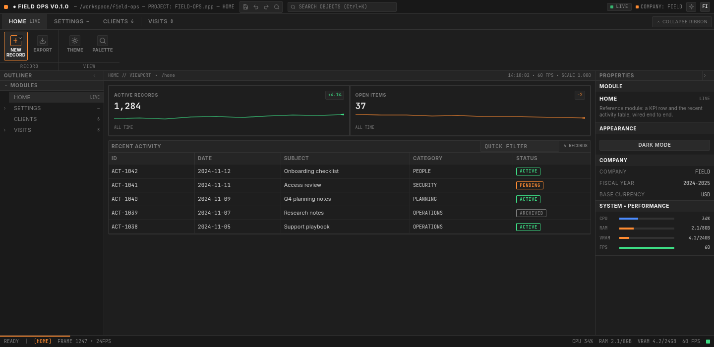
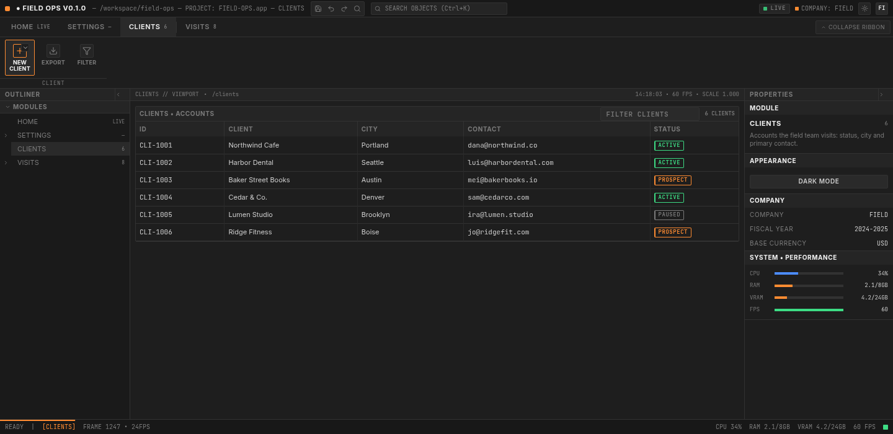
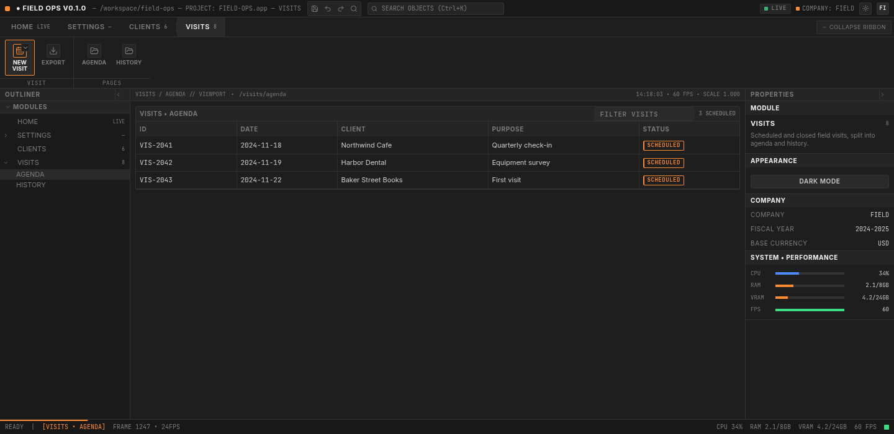

# Proyecto de ejemplo: Field Ops

Prueba de humo real de esta base: crear un proyecto desde cero, agregar dos módulos con un submenú,
rellenar el dominio y verificar. Es a la vez un **walkthrough reproducible** y la evidencia de qué
resuelve la base sola y qué queda en manos de quien la usa.

**Resultado**: 4 comandos de andamiaje (~215 ms cada uno), ~260 líneas escritas a mano y los gates
verdes sin tocar nunca el registro de páginas ni `routeTree.gen.ts`.

| | |
|---|---|
| Proyecto | Field Ops (`field-ops`) — FIELD — USD |
| Módulos | HOME y SETTINGS (de la base) + CLIENTS y VISITS (generados) |
| Submenú | VISITS → AGENDA / HISTORY |
| Datos | 2 recursos mock (`/clients`, `/visits`) con contrato `zod` |
| Verificación | `typecheck`, `lint`, 65 tests, `build`, navegador |

El proyecto se creó en `/tmp/field-ops-clean`, fuera del repo, y es descartable: lo que queda es este
documento, las capturas y los arreglos que la prueba destapó.

## 1. Arranque

Se copia la base (sin `node_modules`, `dist` ni `.git`) y se corre `init`:

```console
$ bun run init --yes --name "Field Ops" --org FIELD --currency USD

Project: Field Ops (field-ops) — FIELD — USD

  ~ src/config/app.ts
  ~ package.json
  ~ README.md
  + .git (repository created)

Next: bun run gen module <id> — then bun run dev.
```

`init` reescribió marca, empresa y moneda por campo (los comentarios de `config/app.ts` sobreviven),
retituló el README, creó el repositorio —la copia no traía `.git`— y dejó un único commit:

```console
$ git log --oneline
89faf00 chore: initialize from template
```

`SPEC.md` quedó intacto a propósito: describe la arquitectura que el proyecto hereda.

## 2. Andamiaje

Cuatro comandos, sin editar nada a mano:

```console
$ bun run gen module clients --label CLIENTS
Module "clients" scaffolded:
  + src/routes/clients.tsx
  + src/routes/clients.index.tsx
  + src/data/clients.ts
  + src/components/clients/ClientsOverview.tsx
  ~ src/config/navigation.ts
  ~ src/routeTree.gen.ts (regenerated)
  (211 ms)

$ bun run gen module visits --label VISITS
Module "visits" scaffolded:
  + src/routes/visits.tsx
  + src/routes/visits.index.tsx
  + src/data/visits.ts
  + src/components/visits/VisitsOverview.tsx
  ~ src/config/navigation.ts
  ~ src/routeTree.gen.ts (regenerated)
  (211 ms)

$ bun run gen page visits agenda --label AGENDA
Page "visits / agenda" scaffolded:
  + src/routes/visits.agenda.tsx
  ~ src/config/navigation.ts
  ~ src/routeTree.gen.ts (regenerated)
  (214 ms)

$ bun run gen page visits history --label HISTORY
Page "visits / history" scaffolded:
  + src/routes/visits.history.tsx
  ~ src/config/navigation.ts
  ~ src/routeTree.gen.ts (regenerated)
  (217 ms)
```

Cada comando termina con el árbol de rutas regenerado, así que `bun run typecheck` y `bun test` ya
pasan en ese momento: no hay un paso intermedio de "abrí el dev server para que se genere".

## 3. Dominio

Lo generado es el andamiaje; el dominio se escribe donde corresponde. Esto es lo que cambió:

| Archivo | Qué se hizo |
|---|---|
| `src/data/clients.ts` | `Client { id, name, city, contact, status }` + fixture de 6 clientes |
| `src/data/visits.ts` | `Visit { id, date, client, purpose, status }` + fixture de 8 visitas |
| `src/components/clients/ClientsOverview.tsx` | columnas CLIENT · CITY · CONTACT · STATUS |
| `src/components/visits/VisitsOverview.tsx` | columnas ID · DATE · CLIENT · PURPOSE · STATUS y `title` por página |
| `src/routes/visits.agenda.tsx` | loader + `visitsQueryOptions` filtrando `SCHEDULED` |
| `src/routes/visits.history.tsx` | mismo recurso, filtrando lo cerrado |
| `src/config/navigation.ts` | contadores, descripciones y los menús del ribbon |

Los dos recursos siguen el contrato de la base: interfaz escrita a mano, schema `zod` anotado
`z.ZodType<T>`, fixture validado con el mismo schema, `fetch` que respeta `DATA_SOURCE` y
`queryOptions` con su `queryKey`. El fixture de visitas, por ejemplo:

```ts
const FIXTURE: VisitsData = {
  visits: [
    { id: "VIS-2041", date: "2024-11-18", client: "Northwind Cafe",
      purpose: "Quarterly check-in", status: "SCHEDULED" },
    // …
  ],
  totalLabel: "8 VISITS",
};
```

El menú del módulo CLIENTS se declara como datos, sin JSX:

```ts
ribbon: [
  {
    label: "Client",
    actions: [
      {
        id: "new-client", size: "large", icon: "plus", label: "New\nClient", tone: "accent",
        notify: { kind: "INFO", title: "NEW CLIENT", message: "Client composer — CLI-1007" },
        menu: [
          { id: "new-client-form", label: "New Client", icon: "plus", notify: { … } },
          { id: "import-csv", label: "Import CSV", icon: "import", notify: { … } },
          { id: "export-csv", label: "Export CSV", icon: "export", notify: { … } },
        ],
      },
      { id: "export", size: "large", icon: "export", label: "Export", notify: { … } },
      { id: "filter", size: "large", icon: "filter", label: "Filter", notify: { … } },
    ],
  },
],
```

Las tres acciones van como `size: "large"`: con una a tres acciones el grupo usa tiles de 58px y llena
los 75px útiles del ribbon (con botones chicos, la columna queda con un hueco visible). Ese presupuesto
también decide que AGENDA/HISTORY se pinten como tiles.

Las páginas AGENDA y HISTORY **no** se registraron a mano: `gen page` las agregó a `PAGES` y con eso
aparecieron solas en el outliner, en el grupo `Pages` del ribbon y en la paleta.

## 4. Verificación

```console
$ bun run typecheck
$ tsc --noEmit

$ bun run lint
Checked 89 files in 8ms. No fixes applied.

$ bun test
 0 fail
 234 expect() calls
Ran 65 tests across 14 files. [1023.00ms]

$ bun run build
dist/assets/index-BTpIK0z2.js   447.04 kB │ gzip: 138.49 kB
✓ built in 214ms
```

Los 65 tests incluyen el **guardarraíl de navegación**, que no hubo que tocar: al regenerar el árbol
detectó los dos módulos y las dos páginas nuevas y verificó en las dos direcciones que el registro y
las rutas coinciden. También pasan los tests de los recursos: el adaptador mock valida los fixtures
nuevos contra su schema.

## 5. Capturas

HOME — el módulo de referencia de la base, ya con la marca del proyecto:



CLIENTS — módulo generado y rellenado: tabla con 6 cuentas, ribbon con menú de variantes y filtro:



VISITS → AGENDA — página anidada: breadcrumb, árbol del outliner expandido y grupo `Pages` derivado:



## 6. Qué resolvió la base sola

- **10 archivos** generados con la forma canónica: layout con `<Outlet/>`, índice con `loader` +
  `useSuspenseQuery`, recurso con contrato, widget de tabla.
- **Cero ediciones** al registro de páginas, al menú de tabs, al outliner o a la paleta: todo salió de
  `PAGES`/`MODULES`.
- **Cero ediciones** a `routeTree.gen.ts`: lo regeneró el generador en el mismo comando.
- El tipo `ModulePath` habría rechazado cualquier ruta inexistente en el registro, y el guardarraíl
  cubrió la dirección contraria.
- Ningún componente de la shell se tocó para agregar dos módulos.

## 7. Qué quedó a mano (esperado)

- **Fixtures y columnas**: es el dominio, no hay forma de adivinarlo.
- **Loader de las páginas hijas**: `gen page` emite una página estática; al convertirla en una vista
  con datos hay que agregar `loader` + `useSuspenseQuery` (copiando la forma del índice).
- **Nombres de tipos**: el generador deriva de `clients` los nombres `ClientsRecord` / `ClientsData`.
  Funciona, pero se leen raro; en este ejemplo se renombraron a `Client` y `ClientsData` mientras se
  rellenaba el dominio.
- **Contadores y descripciones** del registro (`count: "6"`, `description: …`), que el generador deja
  como placeholder.

## 8. Hallazgos de la prueba

La prueba destapó tres roces reales. Los tres se corrigieron en la base antes de cerrar este documento:

| Hallazgo | Arreglo |
|---|---|
| `init` **no creaba repositorio** si la copia llegaba sin `.git` (tarball, "Use this template"), pese a prometer "historial nuevo" | `initProject` llama siempre a `resetGitHistory`; el resumen distingue `+ .git (repository created)` de `~ .git (history reset)`. Test nuevo sobre un directorio sin `.git` |
| El resumen de `init` imprimía `~ + .git (repository created)` | El printer respeta el marcador propio de cada entrada |
| `gen page` terminaba con "Next: fill the data fixture and the widgets", aunque una página no tiene fixture | Mensaje propio por comando |

Queda documentado y sin arreglar: los nombres plurales de tipo (§7). Singularizar un id es adivinar
idioma; renombrar al rellenar el dominio es una decisión consciente, no un bug.

## 9. Reproducirlo

```bash
# 1. Copiar la base sin dependencias ni historial
mkdir -p /tmp/field-ops
tar -c --exclude=node_modules --exclude=dist --exclude=.git --exclude=.tanstack \
  -C /ruta/a/tanstack-desktop-erp . | tar -x -C /tmp/field-ops
ln -s /ruta/a/tanstack-desktop-erp/node_modules /tmp/field-ops/node_modules

# 2. Rebrandear + historial nuevo
cd /tmp/field-ops
bun run init --yes --name "Field Ops" --org FIELD --currency USD

# 3. Andamiaje
bun run gen module clients --label CLIENTS
bun run gen module visits --label VISITS
bun run gen page visits agenda --label AGENDA
bun run gen page visits history --label HISTORY

# 4. Dominio: reemplazar los fixtures de src/data y las columnas de los widgets,
#    y ajustar contadores/menús en src/config/navigation.ts

# 5. Verificar
bun run typecheck && bun run lint && bun test && bun run build
bun run dev
```

## 10. Coste medido

| Paso | Tiempo / tamaño |
|---|---|
| `init` | 24 ms (rebrand de 3 archivos + `git init` + commit) |
| `gen module` | ~211 ms (4 archivos + registro + árbol) |
| `gen page` | ~214 ms (1 archivo + registro + árbol) |
| Escritura de dominio | ~260 líneas netas sobre la base, repartidas en 9 archivos |
| `bun test` | 65 tests en ~1 s |
| `bun run build` | 214 ms · chunk de entrada 447 kB (138,5 kB gzip) |

En total: un proyecto navegable con dos módulos, un submenú y dos recursos con contrato, sin escribir a
mano ni una línea de shell, de rutas generadas ni de registro de navegación.
